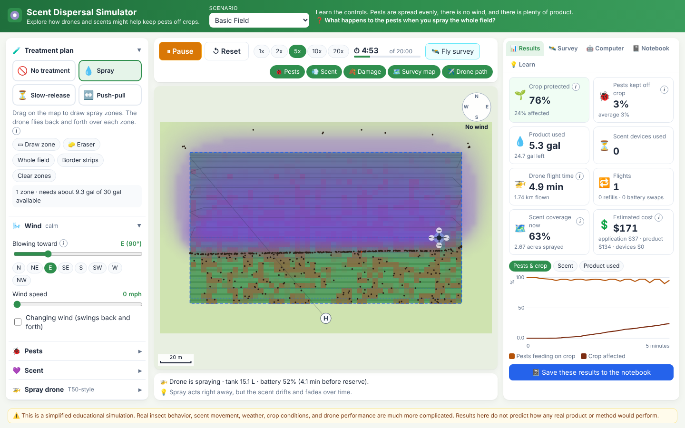

# Scent Dispersal Simulator

A browser-based 2D sandbox for a FIRST LEGO League team. Students explore whether drones could help keep agricultural pests off a crop using scent: repellents, attractants and traps, slow-release devices, push-pull layouts, aerial surveys and computer-optimized plans.

The simulator does not tell students what the right answer is. It gives them a place to make a prediction, run an experiment, see what happens and compare strategies.

> **This is a simplified educational simulation.** Real insect behavior, scent movement, weather, crop conditions and drone performance are much more complicated. Nothing here predicts how a real pesticide, pheromone or product would perform, and the scents are generic ("Repellent A", "Attractant B").



## Run it

You need [Node.js](https://nodejs.org/) 18 or newer.

```bash
npm install
npm run dev      # open the address it prints (usually http://localhost:5173)
```

Other commands:

```bash
npm test         # automated tests (Vitest)
npm run build    # type-check and build the static site into dist/
npm run preview  # serve the built site locally
```

There is no backend, database, login or network dependency. Everything runs in the browser.

## What students can do

| | |
|---|---|
| **Choose a scenario** | Basic Field, Windy Field, Pest Hotspots, Limited Product, Push-Pull, Survey Uncertainty, Limited Flight Time, No Treatment (baseline). |
| **Change the conditions** | Wind direction and speed (and a changing-wind option), pest count, starting pattern, crop attraction, sensitivity, scent strength, lifetime, range and noticing threshold. |
| **Plan a treatment** | *Spray*: drag zones on the map, or use Whole field / Border strips. *Slow-release*: click to place repellent devices. *Push-pull*: place repellent, attractant, and attractant-with-trap devices. *No treatment*: the baseline. |
| **Fly the drone** | A T50-style drone flies the plan, sprays or drops devices, uses battery and payload, and returns home for refills and battery swaps. |
| **Survey** | A separate survey drone scans the field. Its pretend computer-vision output labels squares as healthy, possible damage, high pest activity or uncertain. Fly another survey later to compare before and after. |
| **Let the computer try** | A simple optimizer searches for a plan with the same method and limits, using only what it knows (nothing, or a survey map). Both plans are then tested in the full simulation. Students can change the score weights to decide what "best" means. |
| **Keep a notebook** | Question, prediction, variables changed and kept the same, result, surprises, next steps. Results and settings are saved automatically from the run. Duplicate an experiment to change one thing, compare two side by side, export/import JSON, and print a summary. Stored in the browser's local storage. |

Results shown: crop protected, pests kept off the crop (now and run average), product used and left, devices used, drone flight time, flights, refills and battery swaps, scent coverage, acres sprayed, and estimated cost with its parts. Charts show pests feeding, crop affected, scent coverage and product over time.

## For coaches

The simulator is built to support this activity:

1. Choose a scenario.
2. Make a prediction (Notebook tab → New experiment).
3. Design a treatment.
4. Run the simulation.
5. Record the result (the "Run finished" box has a Save button).
6. Change one variable (Duplicate the experiment, Load this setup, change one thing).
7. Run it again.
8. Compare the results (Notebook → Compare two).
9. Ask why the result changed.
10. Let the optimizer try (Computer tab).
11. Compare its strategy with yours.
12. Discuss whether its result would actually make sense in the real world.

Tips:

- Start with **No Treatment** so the team has a baseline to compare against.
- The **Random seed** makes runs repeatable. *Reset* repeats the same experiment exactly; *New random seed* gives a fresh one.
- In **Survey Uncertainty** the real pests start hidden, as on a real farm. In the Survey tab, open *Instructor / coach view* to show the real pests and real counts.
- The notebook compares runs with plain numbers ("A used 4.2 gallons and protected 76% of the crop…") and never says which is better. Ask "What do you notice?"
- Good discussion prompts: Is spraying everything always better? What happens with short-lived scent? What changes when the survey misses pests? What does "best" mean if product is expensive?

## Simulation model (for review)

Everything is deliberately simple and visible. Constants live in the files named below.

**Map and time.** The map is a rectangle (default 220 × 140 m) with the crop inside a grass border (default 20 m, so the crop is 180 × 100 m ≈ 4.4 acres). Time advances in steps of `dt = 0.5` s of simulated time. At "1x", 10 simulated seconds pass per real second.

**Scent** (`src/simulation/ScentField.ts`, `Wind.ts`). Repellent and attractant are two separate grids of concentration `C` (about 64 squares across). Every step:

1. *Sources add scent.* Spray adds `C × area = (liters / L_ref) × strength`, spread as a Gaussian across the swath, where `L_ref` is 2 gal/acre (so a fresh 2 gal/acre spray reaches about `C = strength`). A slow-release device adds `3 × strength × releaseRate × dt` per step as a Gaussian with σ = range / 2, while it is active (from drop until its lifetime ends).
2. *Wind carries it* (semi-Lagrangian shift): `C_new(x) = C(x − v·dt)`, with `v = 0.3 × wind speed` in the wind direction. The 0.3 stands for slower air near the canopy and keeps plumes on screen.
3. *It spreads* (diffusion): `C += k (sum of 4 neighbors − 4C)` with `k = D·dt / cell²` capped at 0.24 for stability, and `D = 0.5 + 0.15 × wind speed (m/s)` m²/s.
4. *It fades:* `C ×= exp(−dt / lifetime)`.

Scent leaving the map edge is lost. A steady source in wind makes an elongated plume downwind.

**Pests** (`src/simulation/Pest.ts`, `PEST_RULES`). Each pest has a position and heading. Each step its heading is the direction of the sum of:

- wandering: its current heading plus random turning (≈1.1 rad/√s),
- pull toward the nearest point of the crop when off the crop: `1.4 × cropAttraction`,
- away from repellent when `C_rep > 0.5 × threshold`: `−2.6 × sensitivity × min(2, C_rep / threshold) × unit(∇C_rep)`,
- toward attractant when `C_att > 0.5 × threshold`: `+2.2 × sensitivity × min(2, C_att / threshold) × unit(∇C_att)`,
- a push back inside within 4 m of the map edge.

Speed is `speed × 0.2` while feeding (on the crop, repellent below threshold), `speed × 1.6` while bothered by repellent above threshold, and `speed` otherwise. Pests within 4 m of an attractant trap are caught. There is no breeding or death, so pests relocate rather than disappear.

**Crop damage** (`Simulation.ts`). Each feeding pest adds `dt / cellArea` pest-seconds per m² to its grid square. A crop square is *affected* once it reaches 12 pest-seconds/m². *Crop protected* = % of crop squares not affected. *Pests kept off the crop* = % of pests not feeding right now (off the crop, trapped, or bothered by repellent); the notebook also records its average over the run.

**Drone** (`src/simulation/Drone.ts`). Default reference values loosely based on the DJI Agras T50: 40 L tank, 40 kg max payload, 16.5 min hover empty, 7 min hover full. These are reference numbers, not guaranteed mission endurance.

- Endurance (seconds) at payload fraction `p`: `T(p) = (16.5 + (7 − 16.5) p) × 60` (straight line). Liquid weighs 1 kg/L; devices add their mass.
- Battery drops by `dt / T(p)` each airborne step, so heavier loads drain it faster.
- The drone heads home when `battery ≤ reserve + 1.15 × (time to fly home) / T(p)`, when the tank is empty, or when it needs more devices. On the ground it waits the turnaround time, swaps the battery and refills (only as much product as remains in stock), then resumes where it stopped.
- Spray uses `application rate × swath × distance` liters. At 2 gal/acre a 10.5 gal tank covers about 5.25 acres.
- Spray zones become back-and-forth passes one swath apart; zones and device drops are visited nearest-first.

**Survey** (`src/simulation/Survey.ts`). A generic camera drone (12 m/s, 24 m wide view) flies back and forth over the map. Each 10 m square is looked at once, when the drone passes. Each pest in it is detected with the chosen probability and reported at its position plus Gaussian noise; fake detections are added at the chosen rate per 1000 m². The pretend computer-vision labels are: *uncertain* (random, at the chosen rate), *high pest activity* (≥ 4.5 estimated pests per 100 m²), *possible damage* (≥ 1.5 per 100 m², or visible damage), otherwise *healthy*.

**Cost** (`src/simulation/CostModel.ts`). `application = acres sprayed × $/acre` (default $14, from a $12 to $16 benchmark for conventional drone application, product not included), `material = gallons used × $/gal` (placeholder), `devices = devices used × $/device` (placeholder). The simulator does not know the actual cost of the team's product.

**Optimizer** (`src/simulation/Optimizer.ts`). Random search followed by hill climbing:

1. Build "test pests" from what the computer knows: survey detections (with a little jitter), or pests spread evenly over the crop if there is no survey.
2. For the first 35% of tries, make a random plan; afterward, make a small change to the best plan so far (move, add, remove or swap a device or spray block).
3. Reject any plan that breaks the limits (product available, devices available).
4. Score each plan with a quick, coarser simulation (200 pests, `dt = 1` s, grid squares twice as big):
   `score = w₁·%crop protected + w₂·%pests kept off (average) − w₃·gallons − w₄·flight minutes − w₅·(cost / $10)`.
5. Keep the best. At the end, both the student's plan and the computer's plan are run in the full simulation with the real pests and the same seed, and shown side by side. The panel says "The computer found a plan that scored higher using these rules" (or the opposite) and asks why.

## Architecture

```
src/
  simulation/        all simulation logic, no React
    Simulation.ts    one experiment: grids, pests, drone, devices, survey, metrics, history
    ScentField.ts    concentration grid: sources, drift, spread, fade
    Wind.ts          wind vector, changing wind, drift factor, mixing
    Pest.ts          pest swarm (flat arrays) and movement rules
    Drone.ts         T50-style drone: tasks, payload, battery, logistics
    Treatment.ts     plan → drone tasks, devices, method filtering
    Survey.ts        survey drone and pretend computer vision
    Optimizer.ts     scoring, random search + hill climbing
    CostModel.ts     cost calculations
    scenarios.ts     preset scenarios, defaults, JSON parsing
    settingsRules.ts which settings need a reset
  render/drawScene.ts  canvas drawing (field, scent, pests, drones, compass, scale bar)
  components/        React UI (canvas, controls, results, survey, computer, notebook, help)
  notebook/          notebook data, capture, compare, local storage, import/export
  content/help.ts    short explanations used by the info buttons and Learn tab
  models/types.ts    shared plain-data types (everything is JSON-serializable)
  utils/             seeded random numbers, geometry, unit conversions
tests/               Vitest tests for the simulation, optimizer, scenarios and notebook
```

The simulation is plain TypeScript and can run headless (the optimizer and tests do this). React only reads from it and draws it.

## Adding a scenario

Add an entry to `SCENARIOS` in `src/simulation/scenarios.ts`:

```ts
{
  id: 'my-scenario',
  name: 'My Scenario',
  purpose: 'One sentence about what to notice.',
  question: 'A question for students.',
  settings: settingsWith({ treatment: 'spray', wind: { direction: 180, speedMph: 5 } }),
  plan: emptyPlan(),
  view: { showPests: true } // optional
}
```

`settingsWith` starts from the defaults, so you only list what changes. Coaches can also build a scenario in the app (Scenario editor section → Export scenario) and share the JSON file; Import scenario loads it.

## Deploying

`npm run build` writes a static site to `dist/`. It uses relative paths, so it works from any folder:

- **GitHub Pages:** push `dist/` to a `gh-pages` branch, or use a Pages workflow that runs `npm ci && npm run build` and uploads `dist/`.
- **Netlify / Cloudflare Pages / Vercel:** build command `npm run build`, output directory `dist`.
- **Any web server:** copy the contents of `dist/`.

## Manual QA checklist

- [ ] `npm install`, `npm test`, `npm run build` all succeed.
- [ ] `npm run dev` opens the app with no errors in the browser console.
- [ ] Pick each scenario; the description and question change and the map resets.
- [ ] Change wind direction and speed; the compass arrow and wind streaks change.
- [ ] Press Run; pests move. Pause, Resume, Reset and 1x/2x/5x/10x/20x work.
- [ ] Spray: draw a zone, press Whole field or Border strips; the drone flies the passes, the purple cloud appears and drifts with the wind, pests near it turn orange and move away.
- [ ] Payload and battery numbers in the status line go down; the drone returns home at the reserve or when empty (try Limited Flight Time).
- [ ] Slow-release: place devices; with "Drone flies devices out" they start white and turn solid when dropped. The eraser removes devices and zones.
- [ ] Push-pull: repellent pushes pests, attractant pulls them, traps catch some (trapped count rises).
- [ ] Fly survey: the scan footprint moves across the field, then the survey map appears and the run pauses. Camera labels / estimated count switch. Instructor view shows real pests.
- [ ] Run a treatment, fly a second survey, and compare before and after in the Survey tab.
- [ ] Computer tab: Let the computer try shows progress, then a comparison table; Show computer plan / Back to my plan work.
- [ ] Notebook: new experiment, save a finished run, duplicate, load setup, change one thing, run, save, compare two, refresh the page (entries remain), export and import, print summary.
- [ ] Results and charts update while running; the honesty note is visible at the bottom.
- [ ] Layout is usable at tablet width (about 1024 px).

## Known limitations

- Pest behavior is a weighted-rules model, not insect biology. There is no breeding, death (except traps), day/night or species differences.
- Scent drift is a grid shift plus blur; there is no terrain, canopy, rain, temperature or 3D movement. Strong wind blows most scent off a small field quickly.
- Spraying deposits scent directly into the air layer; there is no residue on leaves.
- The drone flies straight lines at constant speed; there are no takeoff, turn or climb costs, and the battery model is a straight line between two hover times.
- The survey's computer vision is simulated from the true pest positions plus noise. It is not a real vision model.
- The optimizer's quick test uses fewer pests and a coarser grid, so its own score can differ from the full-simulation result shown at the end.
- The notebook lives in this browser's local storage. Export it to move it between computers.
- Phones are not a target; tablets and laptops are.

## License

Not yet chosen. Add a license file before sharing beyond the team.
